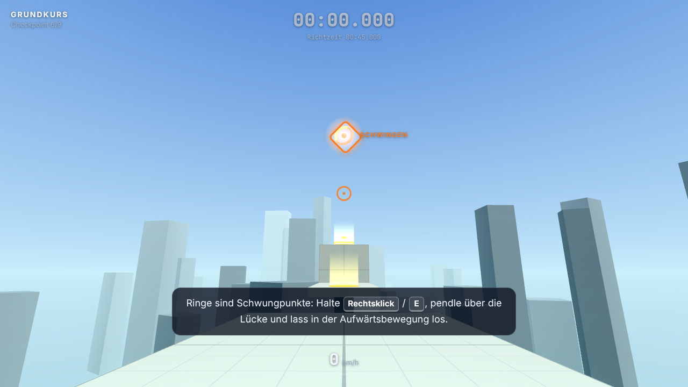

# MOMENTUM

[](https://github.com/codexis-bit/3D-Parkour-Game/actions/workflows/deploy.yml)

MOMENTUM ist ein First-Person-Parkour-Spiel für den Browser. Du läufst an Wänden entlang, slidest
unter Hindernissen hindurch, schwingst dich am Grappling Hook über Abgründe und jagst in drei
Levels deine Bestzeit. Beim Bewegungsgefühl standen Titanfall 2, Mirror's Edge, Ghostrunner und
Karlson Pate: kaum Trägheit am Boden, viel Kontrolle in der Luft, und wer seinen Schwung hält,
ist schneller im Ziel.

Das Spiel ist mit Three.js, der Physik-Engine Rapier und TypeScript gebaut. Texturen, Himmel und
Sounds entstehen zur Laufzeit im Code, Asset-Dateien gibt es keine.



Direkt im Browser spielen: [codexis-bit.github.io/3D-Parkour-Game](https://codexis-bit.github.io/3D-Parkour-Game/)

## Levels

| Level     | Schwierigkeit | Richtzeit | Inhalt                                                                    |
| --------- | ------------- | --------- | ------------------------------------------------------------------------- |
| Grundkurs | leicht        | 0:45      | Führt jede Mechanik einzeln ein, mit Hinweisen an jeder Station           |
| Strömung  | mittel        | 0:40      | Kombiniert Slide, Wall Run, Wall Jump und Grapple zu einer Linie          |
| Abgrund   | schwer        | 1:00      | Lange Sequenzen über dem Nichts, bewegliche Plattformen, zwei Abkürzungen |

Die Zeit startet mit der ersten Bewegung und wird auf die Millisekunde genau gemessen. Bestzeiten
bleiben im `localStorage` des Browsers gespeichert.

## Bewegung

- Laufen mit 9 m/s und Sprünge bis 1,45 m Höhe. Wer die Sprungtaste früh loslässt, springt
  niedriger.
- Coyote Time und Sprungpuffer von je 0,1 s: Ein Sprung kurz nach der Kante oder kurz vor der
  Landung zählt trotzdem.
- Der Wall Run dauert höchstens 1,5 s, die Schwerkraft nimmt dabei langsam zu. An dieselbe Wand
  kommst du erst nach einer anderen Wand oder einer Landung wieder. Der Wall Jump stößt dich von
  der Wand weg.
- Der Slide gibt 3,5 m/s Boost, wird bergab schneller und passt unter niedrige Durchgänge. Ein
  Slide-Jump behält das Tempo.
- Den Grappling Hook gibt es nur an markierten Punkten: Orange Kristalle ziehen dich heran, an
  Ringen pendelst du. Beim Loslassen bleibt der Schwung erhalten.
- Kanten bis Brusthöhe (1,5 m) überwindest du automatisch. Nach Stürzen aus großer Höhe rollst
  du ab, Fallschaden gibt es nicht.
- Rote Zonen und der Abgrund setzen dich zum letzten Checkpoint zurück.

Die Kamera wippt beim Laufen im Schritttakt, neigt sich beim Wall Run von der Wand weg und
weitet das Sichtfeld bei hohem Tempo. Harte Landungen schütteln sie kurz. Head-Bob, Shake und
dynamisches FOV lassen sich im Optionsmenü einzeln abschalten.

## Steuerung

| Aktion                  | Tastatur und Maus  | Gamepad       |
| ----------------------- | ------------------ | ------------- |
| Laufen                  | W A S D            | Linker Stick  |
| Umsehen                 | Maus               | Rechter Stick |
| Springen / Wall Jump    | Leertaste          | A             |
| Sliden / Ducken         | Shift, Strg oder C | B oder L3     |
| Grappling Hook (halten) | Rechtsklick oder E | RT oder RB    |
| Zum letzten Checkpoint  | R                  | Y             |
| Level neu starten       | T                  | Select        |
| Pause                   | Esc oder P         | Start         |
| Debug-Anzeige           | F3                 |               |

Strg+W schließt in vielen Browsern den Tab, deshalb fragt das Spiel beim Schließen während eines
Laufs nach. Zum Sliden sind Shift oder C die sicherere Wahl.

Für die Kamera sperrt das Spiel den Mauszeiger (Pointer Lock). Verweigert der Browser oder ein
eingebetteter Rahmen die Sperre, erscheint die Schaltfläche „Ohne Maussperre spielen“. Dann
schaust du dich mit gedrückter linker Maustaste um, und Esc oder P pausieren.

Im Optionsmenü lassen sich Maus- und Gamepad-Empfindlichkeit, Y-Achse, Sichtfeld (70° bis 120°,
Standard 95°), Lautstärke, die Kamera-Effekte, die Tempo-Einheit und die Grafikqualität
einstellen.

## Lokal starten

Voraussetzung ist Node.js 22.12 oder neuer.

```bash
npm install
npm run dev
```

Danach läuft das Spiel unter http://localhost:5173. Mit `?level=<id>` startet ein Level direkt,
zum Beispiel `?level=flow`. Neben den drei Levels (`tutorial`, `flow`, `challenge`) gibt es zwei
Entwickler-Levels: `sandbox` ist ein Testgelände für alle Mechaniken, `beispiel` das kleine Level
aus dem Abschnitt [Eigene Levels](#eigene-levels).

| Befehl                 | Zweck                                      |
| ---------------------- | ------------------------------------------ |
| `npm run dev`          | Dev-Server mit Hot Reload                  |
| `npm run build`        | Typecheck und Produktions-Build in `dist/` |
| `npm run preview`      | Den Build lokal ansehen                    |
| `npm test`             | Alle Tests einmal (Vitest)                 |
| `npm run test:watch`   | Tests im Watch-Modus                       |
| `npm run lint`         | ESLint                                     |
| `npm run format`       | Prettier über alle Dateien                 |
| `npm run format:check` | Prüfen, ob alles formatiert ist            |
| `npm run typecheck`    | Nur TypeScript prüfen                      |

## Projektstruktur

```text
src/
  main.ts          Einstieg: lädt Rapier, baut das Spiel auf, liest ?level=
  config/          Stellschrauben: movement.ts, camera.ts, input.ts, render.ts
  core/            Game-Loop, fester Physik-Takt, Eingabe, Gamepad, Pointer Lock,
                   Rapier-Anbindung, Event-Bus, Einstellungen, Lauf-Timer
  player/          PlayerController mit Zustandsautomat, Spielerkapsel, Kamera, Seil
  mechanics/       Die einzelnen Moves: Locomotion, Slide, WallRun, WallJump, Grapple, Vault
  level/           Level-Format, Aufbau von Physik und Meshes, Trigger, Plattformen, Validierung
  level/levels/    Die Levels als Daten
  audio/           Prozedurale Sounds über WebAudio
  ui/              HUD, Menüs, Bestzeiten
  debug/           F3-Overlay
tests/             Vitest: Mechaniken, Kamera, Gamepad, Trigger, UI-Logik, Bot-Routen
docs/              Screenshot für diese README
```

Die Physik läuft in festen Schritten mit 60 Hz. Gerendert wird mit Interpolation zwischen den
letzten beiden Schritten, die Maus wirkt dagegen in jedem Frame sofort. Der Spieler ist ein
kinematischer Character Controller von Rapier; seine Zustände (am Boden, in der Luft, Wall Run,
Slide, Grapple, Vault) sind ein Zustandsautomat in `src/player/PlayerController.ts`.
Kamera-Effekte und Sounds reagieren über einen typisierten Event-Bus (`src/core/events.ts`) auf
Sprünge, Landungen, Checkpoints und andere Ereignisse, in die Bewegung greifen sie nicht ein.

## Movement anpassen

Alle Bewegungswerte stehen in `src/config/movement.ts`, die Kamera-Effekte in
`src/config/camera.ts`. Der Dev-Server lädt nach dem Speichern neu. Mit diesen Werten fängst du
am besten an:

| Wert                                                       | Standard            | Wirkung                                                               |
| ---------------------------------------------------------- | ------------------- | --------------------------------------------------------------------- |
| `ground.runSpeed`, `ground.acceleration`                   | 9 m/s, 70 m/s²      | Grundtempo und wie direkt die Figur anzieht                           |
| `gravity`, `jump.height`                                   | 26 m/s², 1,45 m     | Mehr Gravitation bei gleicher Höhe ergibt kürzere, knackigere Sprünge |
| `air.acceleration`                                         | 16 m/s²             | Luftkontrolle                                                         |
| `jump.coyoteTime`, `jump.bufferTime`                       | je 0,1 s            | Wie nachsichtig das Sprung-Timing ist                                 |
| `slide.boost`, `slide.friction`, `slide.slopeAcceleration` | 3,5 m/s, 4, 1,1     | Wie viel Tempo ein Slide bringt und wie lange er es hält              |
| `wallRun.duration`, `wallRun.speed`, `wallRun.gravityEnd`  | 1,5 s, 11 m/s, 0,55 | Länge und Tempo des Wall Runs, Absacken gegen Ende                    |
| `wallJump.upSpeed`, `wallJump.outSpeed`                    | 7,5 m/s, 6,5 m/s    | Höhe und Weite des Wall Jumps                                         |
| `grapple.pullMaxSpeed`, `grapple.swingGravityScale`        | 26 m/s, 0,8         | Zugtempo am Kristall und Schwung am Ring                              |

Die Levels sind auf diese Werte abgestimmt. `npm test` lässt einen Bot mit festen Eingaben durch
alle drei Levels und beide Abkürzungen laufen. Schlägt eine Route nach einer Änderung fehl, passt
entweder die Route oder eine Lücke im Level nicht mehr zu den neuen Werten. Im Spiel zeigt F3
Zustand, Tempo, Timer und Collider live an, `?level=sandbox` bietet Blöcke, Stufen, Rampen und
Wände zum Ausprobieren.

## Eigene Levels

Ein Level ist ein Datenobjekt vom Typ `LevelData` (`src/level/types.ts`). Koordinaten sind in
Metern, Y zeigt nach oben. Mit `yaw: 0` blickt der Spieler nach −Z, +X ist rechts. Das folgende
Beispiel liegt als `src/level/levels/example.ts` im Repo und ist unter `?level=beispiel` spielbar:

```ts
import type { LevelData } from '../types';

export const exampleLevel: LevelData = {
  id: 'beispiel',
  name: 'Beispiel',
  subtitle: 'Sprung, Kante, Rampe',
  difficulty: 1,
  parTime: 12,
  spawn: { pos: [0, 0, 0], yaw: 0 },
  killY: -15,
  elements: [
    // Startplattform: Oberkante auf y = 0, reicht von z = 2 bis z = -18
    { type: 'platform', pos: [0, -0.5, -8], size: [8, 1, 20] },
    {
      type: 'hint',
      pos: [0, -1, -8],
      size: [12, 6, 20],
      text: 'Lauf mit [W] los und spring mit [Leertaste] über die Lücke.',
    },
    // 3 m Lücke, dann die zweite Plattform mit Checkpoint
    { type: 'platform', pos: [0, -0.5, -32], size: [8, 1, 22] },
    { type: 'checkpoint', pos: [0, 0, -24], yaw: 0 },
    // 1 m hohe Kante: Dagegenlaufen zieht automatisch hoch
    { type: 'platform', pos: [0, 0.5, -32], size: [8, 1, 2], style: 'trim' },
    // Rampe hinauf zur Zielplattform
    { type: 'ramp', from: [0, 0, -43], to: [0, 3, -55], width: 6 },
    { type: 'platform', pos: [0, 2.5, -61], size: [8, 1, 12] },
    { type: 'goal', pos: [0, 3, -64] },
  ],
};
```

Diese Elementtypen gibt es:

| `type`        | Beschreibung                                                                                   |
| ------------- | ---------------------------------------------------------------------------------------------- |
| `platform`    | Begehbare Box (Boden, Block, Säule), `pos` ist die Mitte, `size` die Kantenlängen              |
| `wallrun`     | Blaue Wand für Wall Run und Wall Jump                                                          |
| `ramp`        | Schräge von `from` nach `to` (jeweils Mitte der Oberkante) mit Breite `width`                  |
| `slideTunnel` | Niedriger Durchgang mit Decke und Seitenwänden; `clearance` muss zwischen 1,0 und 1,8 m liegen |
| `grapple`     | Grapple-Punkt: `mode: 'pull'` zieht heran, `'swing'` lässt pendeln; optional eigene `range`    |
| `checkpoint`  | Respawn-Punkt mit Blickrichtung `yaw` in Grad                                                  |
| `killZone`    | Rote Zone, die beim Berühren zum Checkpoint zurücksetzt                                        |
| `moving`      | Plattform, die `path` mit `speed` abfährt (`pingpong` oder `loop`, Wartezeit `wait`)           |
| `jumpPad`     | Katapult mit Abfluggeschwindigkeit `power`; Steighöhe etwa `power² / 52` m                     |
| `goal`        | Ziel, genau eines pro Level                                                                    |
| `hint`        | Hinweistext, solange der Spieler im Bereich ist; `[Taste]` erscheint als Tastensymbol          |

Für Strecken entlang −Z gibt es Bau-Helfer in `src/level/levels/helpers.ts` (`deck`, `block`,
`runWall`, `support`, `hint`, `checkpoint`). Die drei mitgelieferten Levels zeigen, wie man damit
längere Abschnitte beschreibt.

So kommt ein neues Level ins Spiel:

1. Datei in `src/level/levels/` anlegen.
2. In `src/level/levels/index.ts` eintragen: `LEVELS` für die Levelauswahl, `DEV_LEVELS` für
   Levels, die nur über `?level=<id>` erreichbar sind.
3. Mit `npm run dev` unter `http://localhost:5173/?level=<id>` testen. F3 zeigt dabei Collider,
   Checkpoints, Ziel, Kill-Zonen und Hinweisbereiche.
4. Das Level in `tests/levels.test.ts` aufnehmen. Dort prüft `validateLevel` die Daten (genau ein
   Ziel, positive Größen, Spawn über der Absturzhöhe, passierbare Tunnel), und ein Physik-Test
   stellt sicher, dass Spawn und Checkpoints frei auf festem Boden stehen. Eine Bot-Route nach dem
   Vorbild in `tests/routes/` beweist zusätzlich, dass das Level schaffbar ist.

## Deployment

`.github/workflows/deploy.yml` führt bei jedem Push und Pull Request Lint, Formatprüfung, Tests
und Build aus. Pushes auf `main` landen danach auf GitHub Pages. Dafür muss Pages einmalig unter
Settings → Pages → Build and deployment → Source auf „GitHub Actions“ stehen. Weil
`vite.config.ts` mit `base: './'` baut, funktioniert der Build in jedem Unterverzeichnis.

## Credits und Lizenz

MIT, siehe [LICENSE](LICENSE). Die verwendeten Bibliotheken und ihre Lizenzen stehen in
[CREDITS.md](CREDITS.md).
